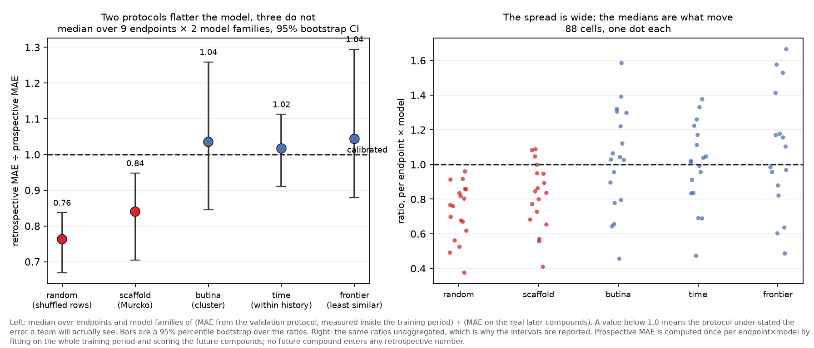
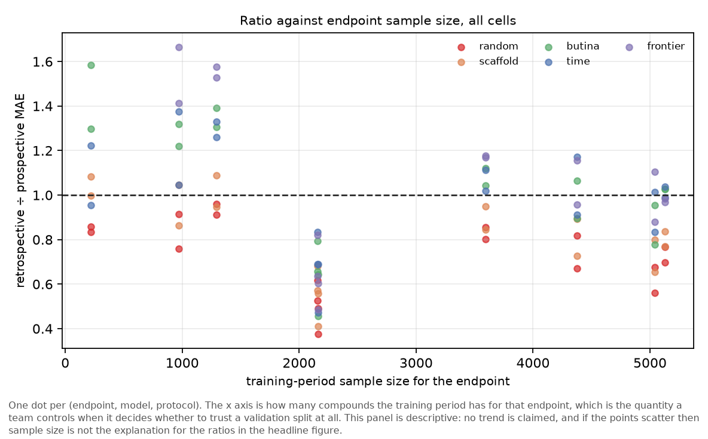

# Does your validation split predict the next batch of compounds?

[](https://github.com/Qwuantabee/admet-split-truth/actions/workflows/tests.yml)
[](LICENSE)

**On a real lead-optimisation program with a time-ordered public split, a random split
under-states the error on the compounds made next by a factor of 0.76, and a Murcko
scaffold split by 0.84. Both are measured against the truth, not against each other.**
Those two numbers are the ridge + random-forest grid below. Adding a third model family
— a graph network — leaves the random-split figure at 0.76 and moves scaffold to 0.80.
The graph network is **not** the better predictor (the forest has the lower error on the
next compounds for five of nine endpoints), and a random split flatters it all the same:
all 27 random-split ratios, across three families and nine endpoints, are below 1.0.

One program, one seed, nine endpoints — read the [limits](#limits-stated-plainly) before
quoting a number.



Every ADMET modelling team validates internally and then decides how far to trust the
model before committing synthesis money. The literature argues about *which split*
gives the best score — random, scaffold, cluster, or time. Nobody reports the quantity
the team actually consumes:

> If my validation says the error is 0.5 log units, what error will I see on the next
> compounds I make?

This measures that directly, on the one public dataset where it is answerable.

## The measurement

| | |
|---|---|
| fields reported today | retrospective error, from a split chosen inside the training data |
| what a project team consumes | error on the compounds produced *after* validation |
| the quantity reported here | **retrospective MAE ÷ prospective MAE**, per protocol |

A ratio of 0.76 means the protocol told the team its error was 24% smaller than it
turned out to be. A ratio of 1.0 is calibrated. Above 1.0 is pessimism.

Prospective MAE is computed **once** per endpoint × model, by fitting on the whole
training period and scoring the later compounds. It never enters a retrospective number.

| protocol | median ratio | 95% CI | |
|---|---|---|---|
| random (shuffled rows) | **0.76** | 0.67–0.84 | excludes 1.0 — optimistic |
| scaffold (Murcko) | **0.84** | 0.70–0.95 | excludes 1.0 — optimistic |
| time (within history) | 1.02 | 0.91–1.11 | calibrated |
| butina (cluster) | 1.04 | 0.85–1.26 | calibrated |
| frontier (least similar) | 1.04 | 0.88–1.29 | calibrated |

Medians over **9 endpoints × 2 model families** (ridge on ECFP4 and a random forest on
ECFP4), 88 cells, 95% percentile bootstrap over the cell ratios. That is 18 ratios per
protocol and 16 for frontier, where the smallest endpoint (MGMB) has too few compounds
to form a fold. The two models on one endpoint share their compounds, so the independent
units are closer to the 9 endpoints than to the 18 ratios — see the limits.

Three things follow.

**The ranking of protocols is the ranking of honesty.** The two protocols most teams
reach for first — a shuffled split, and scaffold grouping — are exactly the two that
under-state future error. The three that hold up are the ones that respect either time
or chemical distance — with the caveat, spelled out in the limits, that two of those
three also fit on less data.

**Scaffold splitting is better than random, but not calibrated.** It closes about a
third of the gap to 1.0 (0.76 → 0.84) and still lands below 1.0 with an interval that
excludes it. "We used scaffold split" is not a warrant that the number transfers.

**A frontier split is not pessimistic here — measured against the future.** Zheng 2026
(arXiv:2607.10729) reports a structural-frontier split inflating error by a taskwise
median of 87% over a matched scaffold split. Here too the frontier split gives a higher
error than the scaffold split, but against the later compounds it is not pessimistic at
all: its ratio is 1.04, interval spanning 1.0. Their study measured retrospective
splits against each other, and this one measures against future data; the two questions
are not the same. Two cautions: the frontier here is a simpler construction than theirs
(lowest fingerprint similarity to a sample of the training period), and it is a single
fold fitted on one sixth of the endpoint's compounds, so it is the least stable of the
five rows.

## Where the bias is largest

The optimism is not uniform. Per-endpoint medians, random split:

| endpoint | ratio | prospective MAE (log10) |
|---|---|---|
| Caco-2 efflux | **0.43** | 0.52 |
| Caco-2 Papp A>B | 0.57 | 0.58 |
| LogD | 0.62 | 0.65 |
| KSOL | 0.73 | 0.55 |
| MLM CLint | 0.74 | 0.47 |
| HLM CLint | 0.83 | 0.42 |
| MBPB | 0.84 | 0.30 |
| MGMB | 0.85 | 0.25 |
| MPPB | 0.94 | 0.29 |

The two permeability endpoints are the ones a random split lies about most, and they
are also the ones whose measured values moved most between periods: Caco-2 Papp shifts
from a training median of 9.82 to 3.23 in the test period, and efflux from 1.38 to 4.99
(raw assay units, from the two source CSVs). That is consistent with distribution shift
driving the optimism. It is not shown to be the mechanism: the ordering is not
monotone — LogD has the third-lowest ratio without a comparable move in its median —
and nine endpoints cannot settle it.

## The honest floor

A model that cannot beat "predict the training mean" on the later compounds is not a
working model, and a ratio computed on it says little. Across the 88 cells, **15** have
a prospective MAE at or above that floor. Prospective MAE is one number per
endpoint × model, so those 15 cells are 3 of the 18 fits, each counted once per
protocol: both fingerprint models on **HLM CLint** (ridge 0.43 and forest 0.41 against a
floor of 0.38) and ridge on **MLM CLint** (0.55 against 0.42; the forest does beat it,
at 0.38). The graph network added below does not change the picture: it edges under the
HLM floor (0.37) and misses the MLM one (0.57). Ratios for those two endpoints are
reported, but they describe models that are barely better than a constant.



The obvious alternative explanation for the headline is sample size: perhaps the
optimism is just what small endpoints do. The panel above puts every cell's ratio
against the training-period sample size for that endpoint. Small endpoints are not the
optimistic ones: the three smallest sit nearest 1.0, and the lowest ratios belong to
the two mid-sized permeability endpoints. If anything the ratios drift *down* as
endpoints get larger, the opposite of what that explanation predicts, though with nine
endpoints that is a tendency and no test is claimed. The figure exists so a reader does
not have to take the paragraph on trust.

## A third model family, because two fingerprints are not two opinions

Ridge and random forest both read the same 2048-bit ECFP4 vector, so their errors are
correlated by construction. If the five protocols only flatter fingerprints, two
families would never show it. A message-passing network that reads the molecular graph
directly is the cheapest test of that, and it swaps only the estimator — the loader,
the five protocols and the ratio definition are imported, not rewritten.

| protocol | GNN median ratio | 95% CI | |
|---|---|---|---|
| random (GNN) | **0.69** | 0.65–0.87 | excludes 1.0 — optimistic |
| scaffold (GNN) | 0.71 | 0.66–1.04 | spans 1.0 |
| butina (GNN) | 0.92 | 0.80–1.11 | calibrated |
| time (GNN) | 0.98 | 0.84–1.25 | calibrated |
| frontier (GNN) | 1.18 | 0.84–1.47 | calibrated |

Re-derived over **all three families together** — 9 endpoints × 3 models, 132 cells:

| protocol | all three families | 95% CI | |
|---|---|---|---|
| random (all three) | **0.76** | 0.67–0.82 | excludes 1.0 — optimistic |
| scaffold (all three) | 0.80 | 0.68–0.89 | excludes 1.0 — optimistic |
| time (all three) | 1.01 | 0.91–1.11 | calibrated |
| butina (all three) | 1.03 | 0.84–1.11 | calibrated |
| frontier (all three) | 1.12 | 0.89–1.20 | calibrated |

The headline survives the change of family. A random split is still the most optimistic
protocol and still excludes 1.0, and the three distance- or time-respecting protocols
still span it. What does *not* fully survive is the scaffold result: under the GNN alone
(nine ratios) its interval spans 1.0; it excludes 1.0 for the two fingerprint families
and for all three pooled. So the claim "scaffold is optimistic but not calibrated" is a
statement about fingerprint models that the graph model does not strengthen. The
random-split finding is the one that holds on every family tested: each family's ratio
is below 1.0 on all nine endpoints.

**The graph model is not the better predictor.** Prospective MAE is lower for the forest
on five of the nine endpoints, and the GNN wins on 4 — Caco-2 Papp A>B, HLM CLint, KSOL
and LogD. Two of its losses are wide: MPPB 0.41 against 0.29, MGMB 0.37 against 0.26.
So is its best win: LogD 0.43 against 0.64. A 4-to-5 split on one seed, with an untuned
network, is a mixed result and not a ranking of the two families. What it does show is
that the optimism of a random split does not depend on which family predicts better: a
family that wins on some endpoints and loses on others is mis-stated in the same
direction on all of them.

## Data

`openadmet/openadmet-expansionrx-challenge-data` (Hugging Face), **CC-BY-4.0, not
gated** — verified through the HF API and by downloading both files.

- 5,326 training compounds, IDs `0001321`–`0020100`.
- 2,282 test compounds, IDs `0020101`–`0027239`.
- **Zero ID overlap, and every test ID exceeds every train ID.** The loader raises if
  that ever stops being true, because the whole project rests on it.
- 9 endpoints. Coverage is uneven and the test order is not random: HLM CLint is
  measured on 67% of training compounds but only 34% of test compounds, while both
  Caco-2 endpoints go the other way (40% → 71%). Assays are run in sequence, so the
  measured subset is selected; coverage is reported per endpoint and nothing is
  imputed.

## Reproducing

```bash
pip install -r requirements.txt
pip install torch            # only for the graph-network leg; CPU is enough

# the grid (downloads the two CSVs into data/raw on first run)
python scripts/run_grid.py

# the third family, same protocols and ratio, estimator swapped
python scripts/run_gnn_grid.py

# figures, then the claim audit and the tests
python scripts/make_figures.py
python scripts/audit_claims.py
pytest tests/
```

`requirements.txt` is pinned to the versions this suite passes on (Python 3.12).
The audit is also a test, so CI fails on a stale number as well as a broken function.
The tests fetch the two source CSVs (under 1 MB together) on first run. Without
PyTorch installed, the two tests that fit the graph network are skipped.

Runtime: `run_grid.py` took 19 minutes of wall clock on a 12-core CPU (it uses every
core) and peaked at 1.4 GB of memory. A rerun reproduced `results/grid.json` to about
12 significant figures; the last digits differ with thread scheduling, so the files
are not byte-identical. `run_gnn_grid.py` was not timed.

## Limits, stated plainly

- **One program, one chemotype.** ExpansionRx is a single lead-optimisation campaign
  (cationic benzimidazole-like RNA binders). The ratios may not transfer to another
  series, and nothing here claims they do. The contribution is the *method* and the
  direction of the bias, which a team can re-measure on its own data with this code.
- **ID order is treated as time order.** Evidence: the two ID ranges are disjoint and
  strictly ordered, and the dataset card describes the test set as later-stage
  molecules. That is an assumption with support, not a timestamp.
- **The intervals are over cells, not over programs, and the cells are not independent.**
  With 9 endpoints and 3 models from a single program, the 95% bootstrap describes
  variability across endpoint × model combinations and does not account for
  between-program variation. It also resamples each ratio as if it were independent,
  while models fitted to the same endpoint share compounds and a test set, so the
  intervals are narrower than nine independent endpoints justify. Treat them as a
  spread, not a claim about a new program.
- **The protocols do not fit on the same amount of data.** Random, scaffold and Butina
  folds fit on about four fifths of an endpoint's training compounds. The time protocol
  is rolling-origin, so its folds fit on between one sixth and five sixths, and the
  frontier protocol is a single fold fitted on one sixth. Less training data raises
  retrospective error by itself, which pushes those two ratios upward for a reason that
  has nothing to do with time or chemical distance. Butina is the clean comparison: same
  training fraction as random, and its interval spans 1.0.
- **One seed, one fold assignment.** Every number comes from a single run. There is no
  repeat over seeds and no shuffled-label control; the only baseline is the
  predict-the-training-mean floor.
- **Three model families, and the third is deliberately untuned.** One architecture,
  one set of hyper-parameters, fixed seed. It was not searched until it won, so its
  per-protocol ratios are a fair second opinion but not the best a graph model can do.
  A tuned GNN could shift these numbers; the direction of the random-split bias is not
  something tuning is expected to remove.
- **The frontier protocol uses a sampled similarity estimate** (400 reference
  compounds) to order the folds. It affects fold composition, not correctness, but it
  is an approximation stated rather than hidden.
- **The null result was a live possibility and did not occur.** Had all five intervals
  spanned 1.0, that would have shipped as the finding. Three do span it, and they are
  reported that way.

## Corrections kept in the history

Numbers here have been wrong, and each was corrected in place rather than dropped.
The limits section said two of the five intervals span 1.0; three do. "For two endpoints
the model never beats the training-mean floor" was false — the forest beats the MLM
CLint floor, and the 15 flagged cells are 3 fits counted once per protocol. A
prospective MAE quoted as 0.27 is 0.26, and scaffold splitting closes about a third of
the gap to 1.0, not half. One test asserted an exception the loader cannot raise and was
fixed with its reason (`tests/test_invariants.py`). `scripts/audit_claims.py` exists
because prose numbers drifted from the tables they came from; it now binds every number
to the phrase in front of it, so the same drift fails CI.

## Layout

```
src/admet_split/data.py     loader, time-order verification, log10 scaling, coverage
src/admet_split/splits.py   the five validation protocols
src/admet_split/gnn.py      the third family: a message-passing network on the graph
scripts/run_grid.py         the measurement: retrospective vs prospective MAE
scripts/run_gnn_grid.py     the same measurement with the graph model swapped in
scripts/make_figures.py     figures from the committed artefact
scripts/audit_claims.py     every README number against results/grid.json
                            and results/gnn_grid.json
tests/                      time-order invariant, protocol invariants, the GNN's
                            determinism and non-redefinition, the claim audit
```

MIT licence for this repository's own code. The ExpansionRx data keeps its own terms
(CC-BY-4.0).

## Part of a set

Six repos, one method: take the number a field reports, measure what a practitioner uses, publish
the gap.

- admet-split-truth: does a validation split predict error on the next compounds?
- [mlip-fidelity](https://github.com/Qwuantabee/mlip-fidelity): do ML potentials rank near-degenerate conformers correctly?
- [epistasis-ceiling](https://github.com/Qwuantabee/epistasis-ceiling): do single-mutant effects add up on a double mutant?
- [variant-effect-prediction](https://github.com/Qwuantabee/variant-effect-prediction): does a cleaner assay target help zero-shot ESM-2?
- [single-cell-de](https://github.com/Qwuantabee/single-cell-de): are cells replicates?
- [enzyme-kinetics](https://github.com/Qwuantabee/enzyme-kinetics): how wrong is a Lineweaver-Burk Km?

Overview: https://github.com/Qwuantabee
